# VOLTIX — Industrial Smart Energy Management Platform

**VOLTIX** is a unified, real-time smart energy management and industrial electrical telemetry platform built with React, TypeScript, Vite, and Tailwind CSS. The platform delivers sub-second phase monitoring, power quality analysis, heuristic forecasting, and fleet provisioning under an industrial-grade dark telemetry interface.

---

## 1. System Architecture

The following architecture diagram details the component hierarchy, data flows, client-side persistence tiers, and hardware gateway integration layers:

```mermaid
flowchart TD
    subgraph UI_Layer ["VOLTIX Presentation & Routing Tier"]
        TopNav["Top Navigation Bar<br/>(Live Telemetry Ticker, Gateway Status, Subnet Discovery)"]
        Sidebar["Telemetry Navigation Rail<br/>(9 Industrial Routes + Aliases)"]
        AppLayout["App Layout Shell<br/>(Persistent Simulation Disclaimer Banner, Toast System)"]
        
        subgraph Pages ["9 Functional Modules"]
            P1["Overview Dashboard (/)"]
            P2["Live Hardware Monitoring (/live-monitoring)"]
            P3["Energy Analytics (/energy-analytics)"]
            P4["AI Predictions & Forecasting (/ai-predictions)"]
            P5["Device Management (/device-management)"]
            P6["Alerts & Notifications (/alerts)"]
            P7["Smart Recommendations (/recommendations)"]
            P8["Reports & Audit Dossier (/reports)"]
            P9["System Settings (/settings)"]
        end
    end

    subgraph State_Layer ["Reactive Context & State Management"]
        TCtx["TelemetryContext<br/>(Stream Controller, Fleet State, Buffer Array)"]
        ToCtx["ToastContext<br/>(Audible/Visual Industrial Dispatch System)"]
        LS["Browser Storage (localStorage)<br/>• voltix_platform_settings<br/>• voltix_device_fleet"]
    end

    subgraph Simulation_Engine ["Virtual Physics & Simulation Engine"]
        MockEngine["mockTelemetryService.ts<br/>• 3-Phase Voltage/Current Waveforms<br/>• Grid Frequency Jitter (49.50 - 50.50 Hz)<br/>• Harmonic Distortion & Load Profiles"]
        Oscilloscope["60-Sample Rolling Waveform Buffer"]
        RuleEngine["Transparent Heuristic Rules<br/>(APFC, Peak Shift, Phase Balance, Idle Creep)"]
    end

    subgraph Hardware_Gateway ["Physical Hardware Integration Layer"]
        HWService["hardwareTelemetryService.ts<br/>(Strict Hardware Abstraction)"]
        WSClient["WebSocket Client<br/>(Challenge Frame: vtx_sec_auth)"]
        StaleWatcher["12-Second Stale Telemetry Detector"]
        Provisioner["deviceService.ts<br/>(C++ config.h Header Generator)"]
    end

    subgraph External_Tiers ["Future Backend & Edge Devices (Offline)"]
        ESP32["Physical ESP32 Microcontrollers<br/>(PZEM-004T / ADS1115 CT Sensors)"]
        FastAPI["Future Python FastAPI Microservices"]
        TimescaleDB["Future TimescaleDB / PostgreSQL Cluster"]
    end

    %% UI Connections
    AppLayout --> TopNav
    AppLayout --> Sidebar
    AppLayout --> Pages
    Pages --> TCtx
    Pages --> ToCtx

    %% State Connections
    TCtx <--> LS
    TCtx <--> MockEngine
    MockEngine --> Oscilloscope
    Pages --> RuleEngine

    %% Hardware Connections
    TCtx <--> HWService
    HWService --> WSClient
    WSClient --> StaleWatcher
    P5 --> Provisioner
    Provisioner -.->|"Compile & Flash config.h"| ESP32
    WSClient -.->|"Pending Network Link"| ESP32
    Pages -.->|"Future REST Ingest"| FastAPI
    FastAPI -.->|"Future Time-Series Storage"| TimescaleDB

    classDef primary fill:#131b2e,stroke:#4cd7f6,stroke-width:2px,color:#dae2fd;
    classDef virtual fill:#171f33,stroke:#ffb95f,stroke-width:2px,color:#dae2fd;
    classDef hardware fill:#0b1326,stroke:#4edea3,stroke-width:2px,color:#dae2fd;
    classDef future fill:#060e20,stroke:#869397,stroke-dasharray: 5 5,stroke-width:1px,color:#869397;

    class UI_Layer,Pages,P1,P2,P3,P4,P5,P6,P7,P8,P9 primary;
    class Simulation_Engine,MockEngine,Oscilloscope,RuleEngine virtual;
    class Hardware_Gateway,HWService,WSClient,StaleWatcher,Provisioner hardware;
    class External_Tiers,ESP32,FastAPI,TimescaleDB future;
```



---

## 2. Core Functional Modules

1. **Overview Dashboard (`/`)**: High-level facility telemetry, 24-hour power curve, phase load distribution, quick actions, and real-time power factor metrics.
2. **Live Hardware Monitoring (`/live-monitoring`, `/monitoring`)**: Sub-second oscilloscope waveform stream, harmonic distortion radar, phase voltage/current vectors, zero-calibration triggers, and virtual relay breaker testing.
3. **Energy Analytics (`/energy-analytics`, `/analytics`)**: Phase-wise load factor analysis, time-of-use tariff breakdown, vector SVG consumption profiles, and historical telemetry comparisons.
4. **AI Predictions & Synthetic Forecasting (`/ai-predictions`, `/predictions`)**: Heuristic statistical extrapolation, 48-hour forward projection confidence envelopes (±0.42σ), and automated anomaly diagnostics clearly labeled as synthetic demo profiles.
5. **Device Management (`/device-management`, `/devices`)**: Discovered virtual node sweeps, fleet status monitoring, offline C++ `config.h` firmware provisioning, and JSON fleet manifest export.
6. **Alerts & Notifications (`/alerts`)**: Multi-severity incident dispatcher (Critical, Warning, Info), surge test injection, root-cause diagnostics, and workflow acknowledgment.
7. **Smart Recommendations (`/recommendations`)**: Transparent rule-based optimization directives (APFC capacitor engagement, chiller pre-cooling load shift, phase rebalancing, standby parasitics cut).
8. **Reports & Audit Dossier (`/reports`)**: RFC 4180 CSV export and structured JSON telemetry dossier export with dynamic column selection and live tariff cost projections.
9. **System Settings (`/settings`)**: Physics engine jitter tuning, grid frequency configuration, voltage sag/swell toggles, hardware gateway configuration, and `localStorage` persistence.

---

## 3. Industrial Telemetry Design Tokens

VOLTIX follows an industrial rack-mount control console aesthetic defined in [`industrial_telemetry/DESIGN.md`](file:///c:/Users/Varun/Desktop/stitch_voltix_smart_energy_platform/industrial_telemetry/DESIGN.md):

- **Background / Surface Base:** Deep obsidian `#0B1326` and slate containers (`#131B2E`, `#171F33`, `#222A3D`).
- **Primary Electric Cyan:** `#4CD7F6` (Active circuits, primary telemetry traces, glow focus).
- **Secondary Emerald:** `#4EDEA3` (Nominal power factor, safe operating envelope, energy efficiency).
- **Tertiary Amber:** `#FFB95F` (Simulation status indicators, warning states, transient events).
- **Error / Fault Crimson:** `#FFB4AB` (Relay trips, voltage surges, critical overcurrent).
- **Typography:**
  - *Headlines & Titles:* Space Grotesk
  - *Body Text:* Geist
  - *Data Tables, Units & Telemetry Readouts:* JetBrains Mono with `tabular-nums`

---

## 4. Hardware Connection & Security Protocol

VOLTIX enforces a strict hardware honesty policy:
- **Simulation Mode Default:** The platform boots in simulation mode. No telemetry is labeled as genuine hardware readings unless physical verification passes.
- **Handshake Challenge:** On gateway connection (`ws://<ip>:<port>/pzem`), the client sends:
  ```json
  {
    "type": "handshake",
    "client": "VOLTIX_GATEWAY_CONSOLE",
    "token": "vtx_sec_auth",
    "timestamp": 1741549200000
  }
  ```
- **Authentication & Telemetry Verification:** The gateway transitions to `CONNECTED` only if the ESP32 returns valid telemetry with verified node identifiers and numeric sensor frames (`v_rms`, `i_rms`, `p_active`).
- **12-Second Stale Watcher:** If no packet is received for 12 seconds while `CONNECTED`, the interface automatically transitions to `CONNECTION_LOST`.
- **C++ Offline Provisioning:** Device keys and configuration are provisioned offline into `<node_id>_config.h` before flashing to the microcontroller.

---

## 5. Development & Testing Commands

```bash
# Run local Vite development server
npm run dev

# Run TypeScript compiler check
npx tsc --noEmit

# Production build
npm run build

# Preview production build
npm run preview
```
