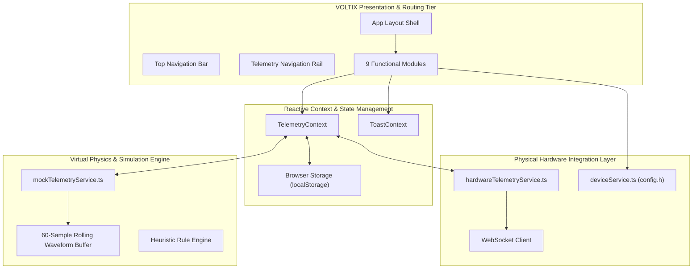

## Brand & Style

The design system embodies an authoritative, precision-engineered industrial IoT aesthetic built for mission-critical grid resilience and real-time energy telemetry. The target audience comprises enterprise plant managers, energy grid engineers, operations directors, and sustainability officers overseeing high-throughput facilities.

The visual language communicates operational calm under load, extreme computational accuracy, and real-time responsiveness. It balances high-density data readouts with distinct visual hierarchies, drawing from dark-mode industrial control consoles and modern glassmorphic enterprise software. Clean semi-translucent backdrops, micro-hairline dividers, tabular typography, and ambient luminous status accents guide the operator’s eye to anomalies, predictive load spikes, and system states without visual exhaustion.

## Colors

The palette is engineered specifically for low-light control rooms and sustained enterprise monitoring. 

- **Primary (`#06B6D4` / Electric Cyan):** Active states, primary action triggers, real-time energy telemetry lines, and system-wide interactive cues.
- **Secondary (`#10B981` / Neon Emerald):** Optimal efficiency ratings, grid generation metrics, active online status nodes, and positive energy arbitrage.
- **Tertiary (`#F59E0B` / Warning Amber):** Predictive load overages, thermal warnings, and scheduled maintenance throttles.
- **Critical Alert (`#F43F5E` / Critical Rose):** Overload conditions, physical device dropouts, critical voltage fluctuations, and automated fail-safes.
- **Base Surfaces & Neutral (`#0A0F1D`, `#0F172A`, `#1E293B`):** Deep charcoal and nightfall navy construct a zero-glare spatial canvas, enabling luminous data traces to pop with crisp legibility.

## Typography

Typography balances technical authority with high data density. 

- **Headlines (Space Grotesk):** Gives high-level KPI readouts and panel headers an architectural, forward-looking structure.
- **Body (Geist):** Serves as the primary reading font across status reports, table cells, and parameter descriptions due to its clean neutral geometry and superior legibility at small sizes.
- **Labels, Telemetry, and Units (JetBrains Mono):** Standardized across all streaming metrics, kilovolt-ampere readouts, timestamp trackers, and tabular matrices. Always enable tabular figures (`font-variant-numeric: tabular-nums`) to prevent horizontal jitter during real-time data streaming.

## Layout & Spacing

The layout is built upon a 12-column fluid responsive grid anchored by persistent left-hand telemetry navigation and a dynamic live-status header.

- **Desktop (1280px+):** 12-column grid, `margin-desktop` (32px), and `gutter-desktop` (24px). Telemetry panels, predictive load charts, and sensor matrices occupy dynamic multi-column blocks (spans of 3, 4, 6, 8, or 12).
- **Tablet (768px - 1279px):** 8-column grid with `margin-tablet` (24px) and standard `gutter` (16px). Secondary charts collapse below primary grid summaries.
- **Mobile (< 768px):** 4-column single-stack flow with `margin` (16px) and `gutter` (16px). Key performance blocks collapse to full-width stacked status tiles with horizontal scrolling data tables.

## Elevation & Depth

Visual hierarchy uses physical-plane layering and technical glassmorphism rather than conventional drop shadows.

- **Canvas Base:** Deep `#0A0F1D` solid plane.
- **Containers & Glass Panels:** Background of `rgba(15, 23, 42, 0.75)` combined with `backdrop-filter: blur(12px)` and a micro-border of `1px solid rgba(255, 255, 255, 0.08)`.
- **Raised Interactive Cards:** Tonal elevation `#1E293B` with border `rgba(6, 182, 212, 0.2)` on active focus, paired with an ambient cyan glow (`box-shadow: 0 0 20px -5px rgba(6, 182, 212, 0.15)`).
- **Critical Floating Overlays / Drawers:** Surface tint `rgba(30, 41, 59, 0.95)`, 16px blur radius, and high-contrast boundary definition `rgba(51, 65, 85, 0.8)`. No muddy black drop shadows; all elevation relies on contrast shifts and boundary luminosity.

## Shapes

The shape architecture is intentionally compact and structured (`roundedness: 1` / 4px base radius). 

Buttons, telemetry badges, data inputs, and system containers utilize crisp 4px corners to reflect an industrial rack-mount instrument panel. Larger dashboard card clusters scale up to `rounded-lg` (8px), maintaining precision without severe organic roundness. Status indicator dots and live pulse halos retain standard circular geometry.

## Components

### Buttons
- **Primary:** Solid `#06B6D4` with `#0A0F1D` high-contrast typography, 4px corner radius, JetBrains Mono medium label, hover shift to `#22D3EE` with a subtle 8px cyan ambient aura.
- **Secondary / Ghost:** `rgba(255, 255, 255, 0.04)` fill, `1px solid rgba(255, 255, 255, 0.1)` border, hover border `#06B6D4`, text in `#F8FAFC`.
- **Destructive / Emergency Stop:** Solid `#F43F5E` base, white label, pulsing ring during armed states.

### Status Chips & Telemetry Badges
- Pill-shaped or 4px micro-tags featuring an inset 6px dot.
- Nominal state: emerald text (`#10B981`) over `rgba(16, 185, 129, 0.1)` container with an optional heartbeat ripple effect.
- Warning state: amber text (`#F59E0B`) over `rgba(245, 158, 11, 0.12)`.
- Overload state: rose text (`#F43F5E`) over `rgba(244, 63, 94, 0.15)`.

### Cards & Grid Containers
- Semi-transparent glass panels with `rgba(255, 255, 255, 0.08)` hairline borders.
- Header bars feature technical subheadings in `label-sm` monospace, uppercase, with a `#64748B` tint.

### Data Tables & Sensor Lists
- Dense tabular layout with alternating row backgrounds (`transparent` vs `rgba(255, 255, 255, 0.02)`).
- Cell dividers set to `1px solid rgba(51, 65, 85, 0.4)`.
- Numerical readouts formatted exclusively in tabular `JetBrains Mono`.

### Inputs & Controls
- Form controls use `#0A0F1D` inset backgrounds with `1px solid #334155`.
- Active focus state transitions border immediately to `#06B6D4` with zero displacement.
- Toggles utilize an industrial slide switch design with electric cyan active track fills.

### Specialized IoT Indicators
- **Heartbeat Pulse Ring:** Live IoT sensor connection displays an animated expanding radial wave behind a solid status core.
- **Sparkline Micro-Charts:** Unadorned vector path charts integrated directly within numeric telemetry blocks.

## System Architecture

